# Bảng kết quả tổng hợp

File này do `scripts/aggregate_results.py` sinh ra, không sửa bằng tay.

## celeba

### Chất lượng

| Mô hình | Run | FID_train-50k | FID_test-10k | KID_test ×10³ | Precision | Recall | Density | Coverage | LPIPS div. |
|---|---|---|---|---|---|---|---|---|---|
| VAE | vae_celeba_full | 68.34 | 68.24 ± 0.13 | 70.72 ± 0.91 | 0.128 | 0.010 | 0.032 | 0.038 | 0.203 |

In đậm: giá trị tốt nhất. Với các cột có ± std, những mô hình chênh giá trị tốt nhất dưới 2 × std được coi là ngang nhau. LPIPS div. không in đậm: giá trị càng gần LPIPS của ảnh thật càng tốt.

Mức tham chiếu thật-với-thật: fid_floor = 2.078, lpips_real = 0.260.

### Chi phí

| Mô hình | Run | Tham số sinh (M) | Tham số train (M) | GMACs/ảnh | GFLOPs/ảnh | Train FLOPs | Giờ train thực tế | Thời gian - RTX 4050 (giờ) | Phần cứng train | Train step | Latency (ms, batch 1) | Throughput (ảnh/s) | ở batch | Peak mem (MB) | Checkpoint (MB) |
|---|---|---|---|---|---|---|---|---|---|---|---|---|---|---|---|
| VAE | vae_celeba_full | 1.74 | 4.53 | 0.028 | 0.056 | 2.78e+15 | 0.68 | 0.68 | NVIDIA GeForce RTX 4050 Laptop GPU (0.68 h) | 127,150 | 1.470 | 18,841.5 | 64 | 32 | 17.3 |

Thời gian - RTX 4050: giờ train trên mọi phần cứng được quy đổi về RTX 4050 theo hệ số k_h = throughput_h / throughput_RTX 4050 từ file calibration (mục 2.5). Tốc độ sinh đo trên NVIDIA GeForce RTX 4050 Laptop GPU, fp32, PyTorch 2.11.0+cu128. MACs đo bằng fvcore 0.1.5.post20221221, batch 1; FLOPs = 2 × MACs.

### Chất lượng theo chi phí train

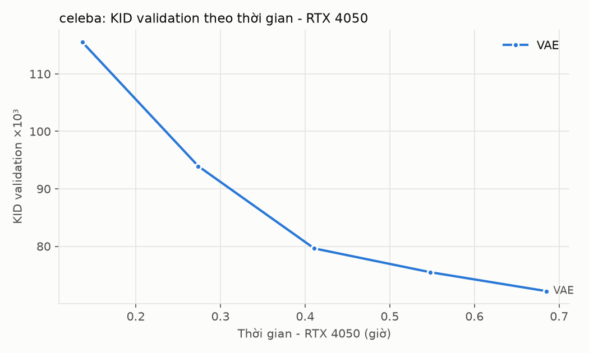

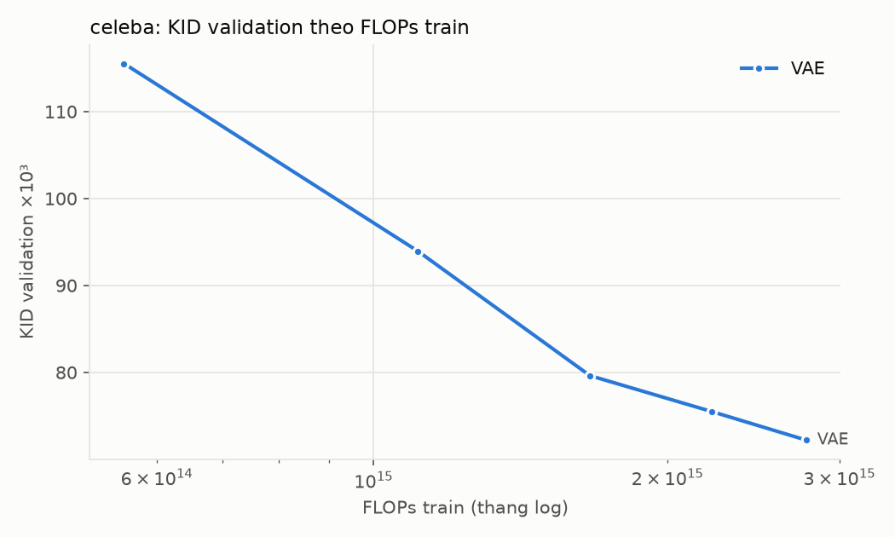

### Ảnh mẫu

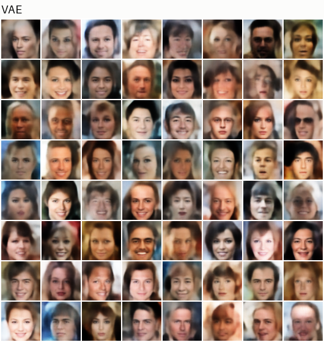

Ảnh mẫu không chọn lọc: cùng seed và cùng số ảnh cho mọi mô hình (scripts/render_samples.py).

### Latent interpolation

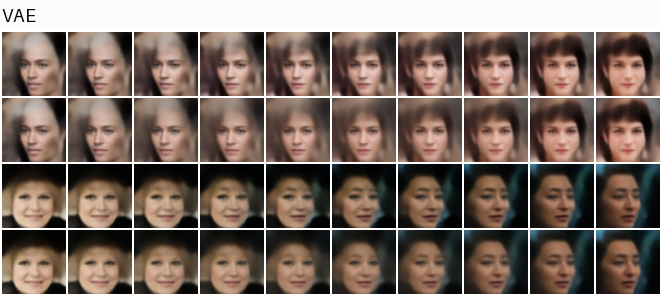

### Nearest-neighbor

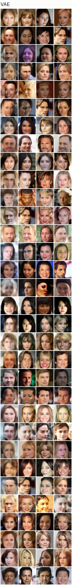

### Các config đã thử

| Mô hình | Run | Giai đoạn | KID_val ×10³ | Thời gian - RTX 4050 (giờ) | Config |
|---|---|---|---|---|---|
| VAE | vae_celeba_tun_beta05 | tuning | 869.54 | 0.20 | configs/vae/celeba/beta05.yaml |

## cifar10

### Chất lượng

| Mô hình | Run | FID_train-50k | FID_test-10k | KID_test ×10³ | Precision | Recall | Density | Coverage | LPIPS div. |
|---|---|---|---|---|---|---|---|---|---|
| VAE | vae_cifar10_full | 127.44 | 130.80 ± 0.13 | 107.51 ± 1.83 | 0.422 | 0.008 | 0.189 | 0.074 | 0.187 |

In đậm: giá trị tốt nhất. Với các cột có ± std, những mô hình chênh giá trị tốt nhất dưới 2 × std được coi là ngang nhau. LPIPS div. không in đậm: giá trị càng gần LPIPS của ảnh thật càng tốt.

Mức tham chiếu thật-với-thật: fid_floor = 5.304, lpips_real = 0.220.

### Chi phí

| Mô hình | Run | Tham số sinh (M) | Tham số train (M) | GMACs/ảnh | GFLOPs/ảnh | Train FLOPs | Giờ train thực tế | Thời gian - RTX 4050 (giờ) | Phần cứng train | Train step | Latency (ms, batch 1) | Throughput (ảnh/s) | ở batch | Peak mem (MB) | Checkpoint (MB) |
|---|---|---|---|---|---|---|---|---|---|---|---|---|---|---|---|
| VAE | vae_cifar10_full | 0.43 | 1.12 | 0.005 | 0.010 | 1.35e+14 | 0.07 | 0.07 | NVIDIA GeForce RTX 4050 Laptop GPU (0.07 h) | 35,150 | 1.350 | 51,755.1 | 256 | 28 | 4.3 |

Thời gian - RTX 4050: giờ train trên mọi phần cứng được quy đổi về RTX 4050 theo hệ số k_h = throughput_h / throughput_RTX 4050 từ file calibration (mục 2.5). Tốc độ sinh đo trên NVIDIA GeForce RTX 4050 Laptop GPU, fp32, PyTorch 2.11.0+cu128. MACs đo bằng fvcore 0.1.5.post20221221, batch 1; FLOPs = 2 × MACs.

### Chất lượng theo chi phí train

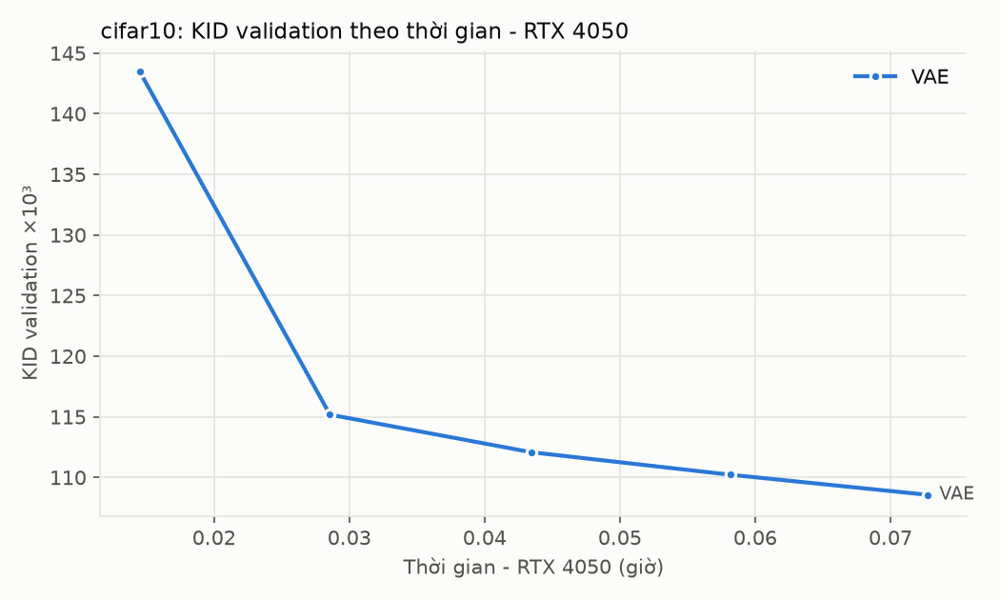

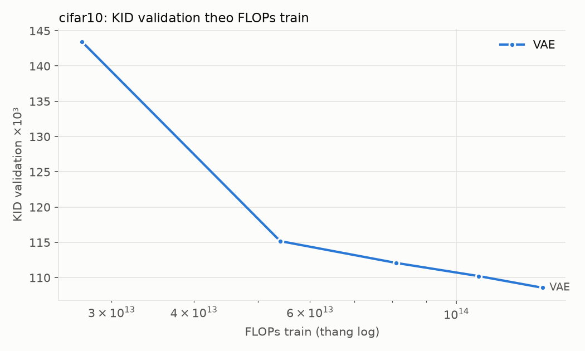

### Ảnh mẫu

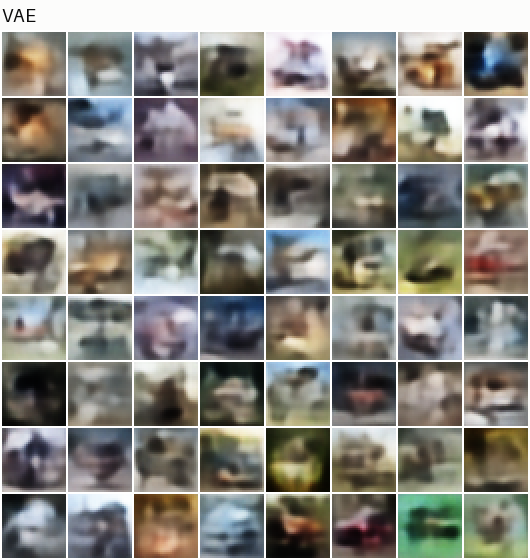

Ảnh mẫu không chọn lọc: cùng seed và cùng số ảnh cho mọi mô hình (scripts/render_samples.py).

### Latent interpolation

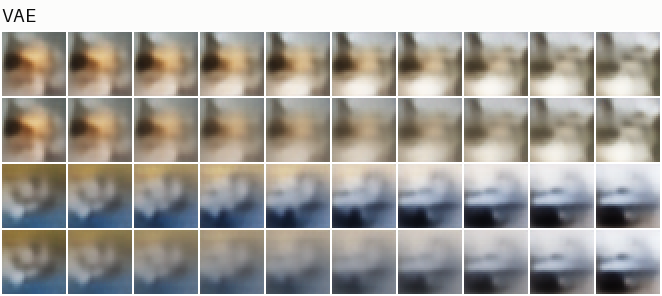

### Nearest-neighbor

### Các config đã thử

| Mô hình | Run | Giai đoạn | KID_val ×10³ | Thời gian - RTX 4050 (giờ) | Config |
|---|---|---|---|---|---|
| VAE | vae_cifar10_tun_beta05 | tuning | 393.67 | 0.03 | configs/vae/cifar10/beta05.yaml |

## fashion_mnist

### Chất lượng

| Mô hình | Run | FID_train-50k | FID_test-10k | KID_test ×10³ | Precision | Recall | Density | Coverage | LPIPS div. |
|---|---|---|---|---|---|---|---|---|---|
| VAE | vae_fashion_mnist_full | 87.62 | 89.65 ± 0.75 | 63.26 ± 1.58 | 0.188 | 0.104 | 0.075 | 0.112 | 0.101 |

In đậm: giá trị tốt nhất. Với các cột có ± std, những mô hình chênh giá trị tốt nhất dưới 2 × std được coi là ngang nhau. LPIPS div. không in đậm: giá trị càng gần LPIPS của ảnh thật càng tốt.

Mức tham chiếu thật-với-thật: fid_floor = 2.911, lpips_real = 0.136, fid_custom_floor = 0.346.

### Chi phí

| Mô hình | Run | Tham số sinh (M) | Tham số train (M) | GMACs/ảnh | GFLOPs/ảnh | Train FLOPs | Giờ train thực tế | Thời gian - RTX 4050 (giờ) | Phần cứng train | Train step | Latency (ms, batch 1) | Throughput (ảnh/s) | ở batch | Peak mem (MB) | Checkpoint (MB) |
|---|---|---|---|---|---|---|---|---|---|---|---|---|---|---|---|
| VAE | vae_fashion_mnist_full | 0.30 | 0.73 | 0.004 | 0.009 | 1.36e+14 | 0.08 | 0.08 | NVIDIA GeForce RTX 4050 Laptop GPU (0.08 h) | 39,050 | 1.112 | 58,515.2 | 256 | 27 | 2.8 |

Thời gian - RTX 4050: giờ train trên mọi phần cứng được quy đổi về RTX 4050 theo hệ số k_h = throughput_h / throughput_RTX 4050 từ file calibration (mục 2.5). Tốc độ sinh đo trên NVIDIA GeForce RTX 4050 Laptop GPU, fp32, PyTorch 2.11.0+cu128. MACs đo bằng fvcore 0.1.5.post20221221, batch 1; FLOPs = 2 × MACs.

### Chất lượng theo chi phí train

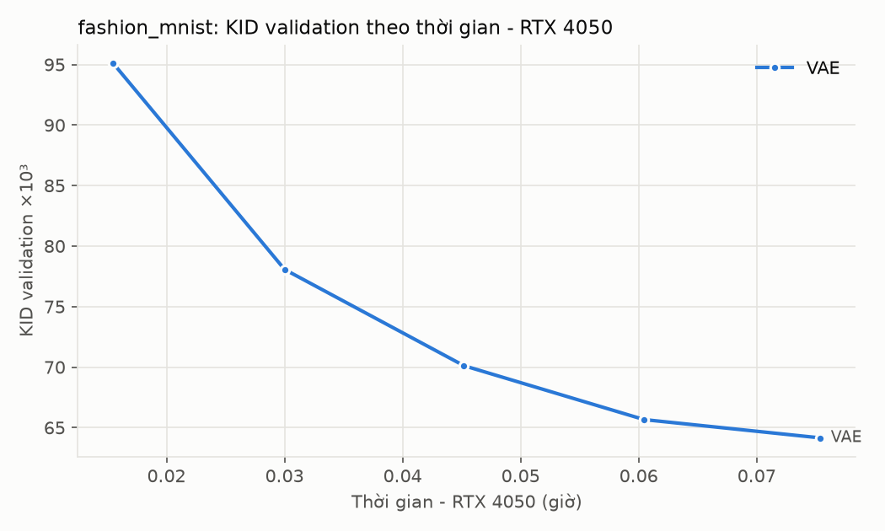

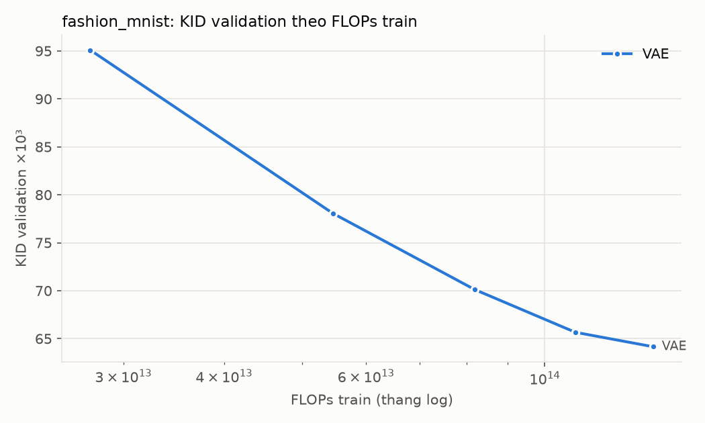

### Ảnh mẫu

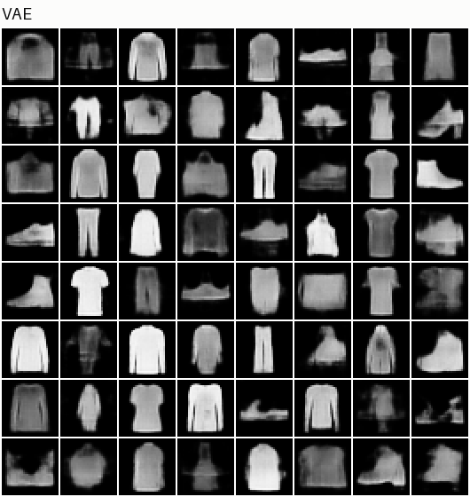

Ảnh mẫu không chọn lọc: cùng seed và cùng số ảnh cho mọi mô hình (scripts/render_samples.py).

### Latent interpolation

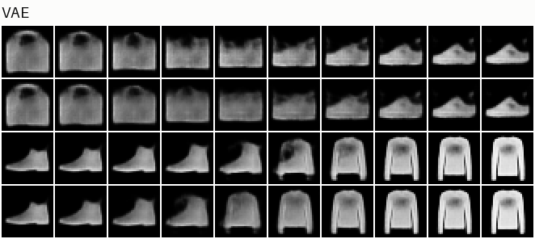

### Nearest-neighbor

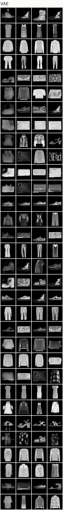

### Các config đã thử

| Mô hình | Run | Giai đoạn | KID_val ×10³ | Thời gian - RTX 4050 (giờ) | Config |
|---|---|---|---|---|---|
| VAE | vae_fashion_mnist_tun_beta05 | tuning | 83.85 | 0.02 | configs/vae/fashion_mnist/beta05.yaml |

## Kiểm tra

**Cảnh báo:**

- [celeba] Chưa có kết quả cho DCGAN.
- [celeba] Chưa có kết quả cho DDPM.
- [cifar10] Chưa có kết quả cho DCGAN.
- [cifar10] Chưa có kết quả cho DDPM.
- [fashion_mnist] Chưa có kết quả cho DCGAN.
- [fashion_mnist] Chưa có kết quả cho DDPM.
